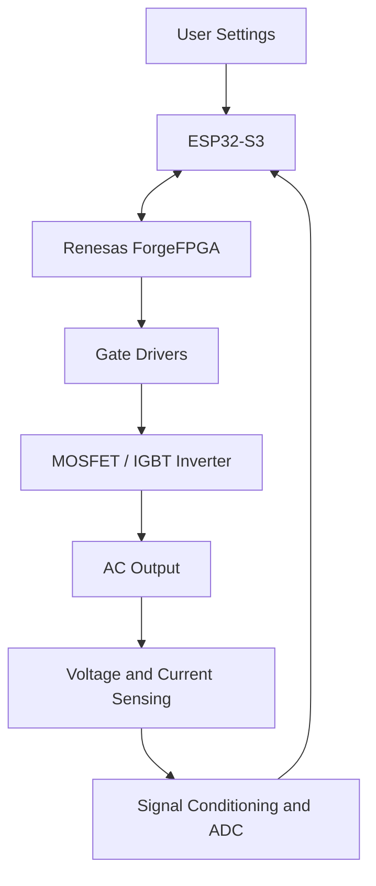

# FPGA-Based Three-Phase SPWM Inverter Using Vicharak Shrike-Fi

### Configurable Digital Control for Three-Phase Power Electronics

**Vicharak Fellowship Project**


---

> [!CAUTION]
> ## IMPORTANT NOTE FOR FELLOWSHIP REVIEWERS
>
>## Project Proposal
>
>The detailed project proposal describes the problem statement, proposed
>architecture, objectives, development plan, expected outcomes, and safety
>scope.
>
>**[Read the Project Proposal](docs/project-proposal.md)**
> **This project is currently in the planning and initial design stage.**
>
> The complete implementation has not yet been developed. The following deliverables are planned for completion within a target period of **six months from project commencement**:
>
> - **ForgeFPGA Verilog HDL:** Three-phase sine-reference generation, SPWM generation, adjustable frequency, modulation-amplitude control, complementary switching and dead-time logic.
> - **Circuit schematic:** A documented design covering sensing interfaces, gate drivers, the inverter power stage and protection circuitry.
> - **PCB design:** PCB layout files and appropriate manufacturing outputs for the planned hardware implementation.
> - **Voltage and current feedback:** Planned sensing, measurement, regulation and fault-handling functionality.
> - **Simulation and validation:** Testbenches, synthesis reports and hardware measurements as implementation progresses.
>
> **The target is to complete the planned implementation and validation within six months.** Development files and verified results will be added to this repository progressively.
>
> The architecture, objectives and roadmap described here represent the intended design. They must not be interpreted as evidence of a completed, synthesized, tested or operational inverter.

---

## Table of Contents

- [1. Project Overview](#1-project-overview)
- [2. Project Objectives](#2-project-objectives)
- [3. Proposed Hardware Platform](#3-proposed-hardware-platform)
- [4. Proposed System Architecture](#4-proposed-system-architecture)
- [5. SPWM Theory and Mathematical Model](#5-spwm-theory-and-mathematical-model)
- [6. Frequency and Voltage Control](#6-frequency-and-voltage-control)
- [7. Voltage and Current Feedback](#7-voltage-and-current-feedback)
- [8. Switching Logic and Protection](#8-switching-logic-and-protection)
- [9. Six-Month Development Roadmap](#9-six-month-development-roadmap)
- [10. Repository Structure](#10-repository-structure)
- [11. Verification Strategy](#11-verification-strategy)
- [12. Safety Considerations](#12-safety-considerations)
- [13. Current Project Status](#13-current-project-status)
- [14. References](#14-references)

---

## 1. Project Overview

This project explores the development of a configurable three-phase sinusoidal pulse-width modulation (SPWM) inverter controller using the **Vicharak Shrike-Fi development platform**.

The Shrike-Fi board combines a Renesas ForgeFPGA with an ESP32-S3 microcontroller. The FPGA is intended to handle timing-critical waveform generation and PWM switching logic, while the microcontroller can provide supervisory control, configuration and an optional user interface.

The proposed system will generate three synchronized PWM switching patterns based on sinusoidal reference signals separated by 120 electrical degrees. These signals will interface with appropriate gate-driver circuitry and a suitable MOSFET- or IGBT-based inverter power stage.

The project will investigate adjustable fundamental frequency, modulation-amplitude control, voltage and current feedback, safe switching, and the integration of FPGA-based digital control with power electronics.

The initial focus will be on developing and verifying the digital control system before progressing to hardware integration.

## 2. Project Objectives

- Understand the Shrike-Fi architecture and Renesas ForgeFPGA development workflow.
- Design the digital control logic using Verilog HDL.
- Generate three sinusoidal reference signals separated by 120 degrees.
- Implement configurable fundamental frequency and modulation amplitude.
- Generate three-phase SPWM switching commands.
- Investigate complementary switching and dead-time insertion.
- Develop an appropriate configuration interface between the FPGA and onboard ESP32-S3.
- Design voltage and current sensing interfaces.
- Investigate closed-loop voltage regulation and current limiting.
- Design the circuit schematic, gate-driver interface and PCB.
- Validate the design through simulation, synthesis and controlled hardware testing.
- Document implementation decisions, results and limitations.

## 3. Proposed Hardware Platform

### 3.1 Vicharak Shrike-Fi Development Board

The Shrike-Fi is the central digital-control platform. It combines two processing elements with complementary responsibilities.

**Renesas ForgeFPGA — digital control engine**

The FPGA is intended to implement:

- Three-phase sine-reference generation.
- Phase accumulation and 120-degree phase displacement.
- Carrier-based SPWM generation.
- Adjustable fundamental frequency and modulation amplitude.
- Complementary switching logic and dead-time insertion.
- Deterministic switching timing and digital fault-response logic.

**ESP32-S3 — supervisory controller**

The onboard microcontroller can support:

- User configuration and control commands.
- Communication with the FPGA through the supported board interface.
- Optional Wi-Fi/Bluetooth-based monitoring and user interaction.
- Supervisory functions and future system extensions.

The exact communication protocol and division of control functions will be established during development.

### 3.2 External Hardware Components

| Component | Intended function |
|---|---|
| Voltage sensing | Measures the relevant inverter output voltage |
| Current sensing | Measures output or power-stage current for monitoring and protection |
| Signal conditioning and ADC | Converts measured electrical quantities into suitable digital measurements |
| Gate-driver circuitry | Interfaces FPGA logic with the power-switch gate requirements |
| MOSFETs or IGBTs | Form the three inverter switching legs |
| DC power supply | Provides the input energy for the inverter |
| Output filter, if required | Attenuates switching-frequency components in the output waveform |

The final component selection, voltage ratings, gate-driver arrangement and protection design will depend on the intended DC bus, output voltage, current and switching frequency.

## 4. Proposed System Architecture

The proposed system separates high-speed FPGA switching logic from supervisory control and feedback processing.



### Signal Flow

1. The user specifies the desired output frequency and voltage level.
2. The ESP32-S3 communicates the settings to the FPGA.
3. The ForgeFPGA generates synchronized three-phase SPWM switching commands.
4. Gate drivers interface the logic signals with the inverter power switches.
5. Voltage and current sensing circuits measure the output and provide feedback for monitoring, regulation and protection.

*This is the proposed architecture. Final signal allocation, sensing interfaces and control-loop placement remain to be determined.*

## 5. SPWM Theory and Mathematical Model

Sinusoidal pulse-width modulation (SPWM) generates PWM switching signals by comparing sinusoidal reference waveforms with a high-frequency triangular carrier.

### 5.1 Three-Phase Sinusoidal References

For a balanced three-phase system, the reference waveforms are defined as follows.

**Phase A**

```math
v_A^*(t)=M\sin(\omega t)
```

**Phase B**

```math
v_B^*(t)=M\sin\left(\omega t-\frac{2\pi}{3}\right)
```

**Phase C**

```math
v_C^*(t)=M\sin\left(\omega t-\frac{4\pi}{3}\right)
```

Where:

- `M` is the normalized modulation amplitude.
- `omega = 2 pi f1` is the fundamental angular frequency.
- `f1` is the commanded fundamental output frequency.
- The three reference signals are separated by 120 electrical degrees.

### 5.2 Carrier-Based PWM Generation

Let `v_tri(t)` represent a normalized triangular carrier.

The ideal upper-switch command for Phase A is:

```math
S_A(t)=
\begin{cases}
1, & v_A^*(t)>v_{\mathrm{tri}}(t)\\
0, & v_A^*(t)\leq v_{\mathrm{tri}}(t)
\end{cases}
```

Equivalent comparisons are performed for phases B and C.

For a conventional two-level inverter, complementary lower-switch commands must be generated with suitable dead time. The lower-switch command must not be treated as an unrestricted logical inverse of the upper-switch signal during switching transitions.

### 5.3 Carrier and Reference Waveforms

The reference signals are three sine waves displaced by 120 degrees. A high-frequency triangular carrier determines the switching instants.

When a phase reference exceeds the carrier, its ideal upper-switch command is high; otherwise, it is low, subject to the implemented switching and safety logic.

### 5.4 Expected SPWM Waveforms

The planned simulation and hardware documentation will include:

- Three sinusoidal reference signals separated by 120 degrees.
- The high-frequency triangular carrier.
- The resulting phase-A, phase-B and phase-C PWM commands.
- Complementary gate commands with dead time.
- Switched line-to-line inverter voltage.
- The fundamental output waveform after suitable filtering.

The output of the inverter is not inherently a pure sine wave at the switching terminals. The power stage, modulation technique and any output filter determine the resulting waveform quality.

All plots will be identified as theoretical, simulated or experimentally measured, as applicable.

## 6. Frequency and Voltage Control

### 6.1 Output Frequency

The fundamental frequency will be adjusted by changing the phase progression in the FPGA.

A digital phase accumulator can be used to advance the electrical angle by a configurable increment on each update.

For an accumulator with `N` phase bits, clock frequency `f_clk`, and phase increment `K`:

```math
f_1=\frac{Kf_{\mathrm{clk}}}{2^N}
```

This equation assumes one phase-accumulator update per clock cycle. If the design uses a clock enable or a separate update rate, the effective update frequency must be used instead.

### 6.2 Modulation Amplitude

The amplitude modulation index is commonly defined as:

```math
m_a=\frac{V_{\mathrm{ref,peak}}}{V_{\mathrm{carrier,peak}}}
```

For conventional linear sinusoidal PWM, operation with a modulation index between zero and one provides a useful initial design range.

Changing the modulation index changes the commanded fundamental output voltage for a fixed DC-link voltage and inverter topology.

The actual voltage depends on the DC bus, modulation method, power stage, load and whether the measurement is phase-to-neutral or line-to-line.

### 6.3 Frequency Modulation Ratio

The frequency modulation ratio is:

```math
m_f=\frac{f_c}{f_1}
```

Where:

- `fc` is the triangular carrier frequency.
- `f1` is the fundamental reference frequency.

The carrier frequency and fundamental output frequency are separate design parameters.

## 7. Voltage and Current Feedback

The planned feedback system will investigate the following functions.

### Voltage Feedback

- Output-voltage measurement.
- RMS voltage estimation.
- Comparison of measured voltage with a voltage setpoint.
- Modulation-amplitude adjustment for output-voltage regulation.

### Current Feedback

- Current measurement.
- Current-limit functionality.
- Detection of abnormal operating conditions.
- Fault reporting and shutdown.

Feedback measurements will require suitable sensing, signal conditioning and ADC interfaces. The final design will determine whether the control calculations are performed by the ESP32-S3, the FPGA or a combination of both.

Fast overcurrent protection and prevention of shoot-through must not rely solely on application software or wireless communication.

## 8. Switching Logic and Protection

The proposed switching controller will investigate:

- Complementary upper- and lower-switch commands.
- Dead-time insertion.
- Safe PWM enable and disable behavior.
- Fault detection and controlled shutdown.
- Appropriate gate-driver interfaces.
- Independent hardware protection for dangerous fault conditions.

A three-phase, two-level inverter normally uses six power switches arranged in three half-bridge legs. The gate-driver circuitry must be suitable for the chosen MOSFETs or IGBTs and the electrical requirements of the power stage.

The final switching architecture and component selection will be documented after the design has been developed and verified.

## 9. Six-Month Development Roadmap

| Period | Planned milestone |
|---|---|
| Month 1 | Study the board, toolchain, requirements and system architecture |
| Month 2 | Develop and simulate phase generation and sine-reference logic |
| Month 3 | Implement configurable SPWM and the FPGA configuration interface |
| Month 4 | Design the circuit schematic, sensing interfaces, protection and PCB |
| Month 5 | Integrate and verify the FPGA logic and hardware interfaces |
| Month 6 | Complete planned validation, documentation and final results |

This is a proposed schedule. The sequence may change depending on hardware availability, synthesis results and integration challenges.

## 10. Repository Structure

```text
shrike-fi-three-phase-spwm-inverter/
├── README.md
├── docs/
│   ├── project-overview.md
│   ├── system-architecture.md
│   ├── spwm-theory.md
│   ├── development-roadmap.md
│   └── safety-and-limitations.md
├── fpga/
│   ├── README.md
│   ├── rtl/
│   ├── constraints/
│   ├── simulation/
│   └── synthesis/
├── hardware/
│   ├── README.md
│   ├── schematics/
│   ├── pcb/
│   ├── bom/
│   └── datasheets/
├── control/
│   ├── voltage-feedback/
│   ├── current-feedback/
│   └── protection/
├── simulation/
│   ├── waveforms/
│   └── test-results/
├── media/
│   ├── architecture/
│   ├── waveforms/
│   └── hardware/
└── results/
    ├── fpga-resource-usage/
    └── measurements/
```

These directories represent the intended organization. Source files, schematic exports, PCB files, simulations and results will be added as they become available.

## 11. Verification Strategy

Planned verification activities include:

- Checking the phase displacement of the three reference waveforms.
- Verifying commanded fundamental frequency and modulation-amplitude updates.
- Checking PWM switching frequency and pulse generation.
- Verifying complementary switching and dead-time behavior.
- Reviewing FPGA synthesis resource utilization and timing.
- Measuring physical digital outputs after FPGA integration.
- Testing sensing, feedback and protection under controlled conditions.

Results will be documented only after the corresponding simulation, synthesis or physical measurement has been performed.

## 12. Safety Considerations

FPGA and microcontroller GPIOs are low-voltage digital interfaces and must not drive inverter power switches directly.

The future power-stage implementation will require appropriate gate drivers, suitable isolation where required, correctly implemented dead time, current limiting and effective hardware fault protection.

Initial development will focus on digital simulation and low-voltage testing. Any higher-voltage implementation will require a properly reviewed circuit and a controlled, appropriately protected test environment.

## 13. Current Project Status

**Current stage: Planning and initial design.**

The project objectives, proposed architecture, repository structure and development roadmap are being established.

The ForgeFPGA Verilog implementation, circuit schematic, PCB design, simulation results and hardware measurements remain planned deliverables.

This repository will serve as the central record of design decisions, implementation progress and verified results throughout the six-month development period.

## 14. References

- [Vicharak Shrike GitHub Repository](https://github.com/vicharak-in/shrike)
- [Vicharak Shrike Documentation](https://vicharak-in.github.io/shrike/)

---

**Project focus:** FPGA-based three-phase SPWM control, adjustable frequency and modulation amplitude, voltage/current feedback, switching protection and a documented hardware implementation.

*This repository is intended for educational and engineering development as part of a Vicharak Fellowship project.*
