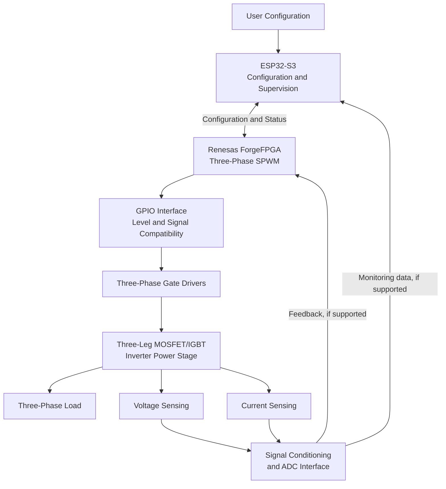

# System Architecture

## 1. Overview

The proposed system uses the Vicharak Shrike-Fi development board to implement a configurable three-phase sinusoidal pulse-width modulation (SPWM) controller.

Shrike-Fi integrates a Renesas ForgeFPGA device and an ESP32-S3 microcontroller. The FPGA is intended to perform deterministic waveform and switching-control tasks, while the ESP32-S3 can provide configuration and supervisory functions.

External sensing, gate-driver, and power-stage circuits will connect to the board through compatible interfaces. Exact pin assignments and electrical interfaces must be confirmed against the official board documentation before hardware implementation.

## 2. High-Level Block Diagram

**Note:** This is a conceptual architecture. The actual feedback destination, ADC arrangement, GPIO allocation, and communication interfaces will be selected after checking the board's capabilities and available pins.

## 3. FPGA Responsibilities

The Renesas ForgeFPGA is intended to handle time-critical digital control functions.

### Planned functional blocks

- Three-phase reference generation
- Phase accumulation and frequency control
- Carrier-based SPWM comparison
- Six coordinated gate-control outputs
- Complementary switching logic
- Dead-time and interlocking logic
- Fault input handling and PWM disable logic, subject to interface design

The implementation will be written in Verilog HDL, subject to the supported ForgeFPGA toolchain and device resources.

## 4. ESP32-S3 Responsibilities

The ESP32-S3 can provide higher-level configuration and supervision.

Potential responsibilities include:

- Accepting frequency and modulation settings
- Sending configuration commands to the FPGA
- Reading available status and fault information
- Providing a user interface or optional wireless configuration
- Recording diagnostic information during development

The ESP32-S3 will not be assumed to provide safety-critical protection by itself. Critical shutdown behavior should be designed to act reliably even if supervisory firmware stops responding.

## 5. SPWM Signal Generation

Three sinusoidal references are separated by 120 electrical degrees:

\[
v_a^* = M\sin(\theta)
\]

\[
v_b^* = M\sin(\theta-120^\circ)
\]

\[
v_c^* = M\sin(\theta+120^\circ)
\]

Here, \(M\) represents the selected modulation amplitude, within the validated operating range.

Each reference is compared with a common triangular carrier to generate a PWM signal. The six gate-control signals correspond to the upper and lower switching devices of the three inverter legs.

Complementary outputs must include suitable dead time to reduce the risk of shoot-through. The required dead time depends on the selected power devices and gate drivers.

## 6. Feedback Architecture

### Voltage feedback

A voltage-sensing circuit will scale and condition the measured signal to match the input requirements of a compatible ADC or other acquisition interface.

### Current feedback

A current sensor will provide a signal proportional to the measured current. Its range, isolation, bandwidth, and conditioning requirements depend on the selected sensor and power stage.

### Acquisition constraints

The design must establish:

- ADC location and resolution
- Sampling rate and timing
- Input voltage range
- Isolation and common-mode requirements
- Filtering and calibration
- Feedback signal routing within the available GPIO budget

The feedback hardware and interface are not yet finalized.

## 7. Gate Drivers and Power Stage

The FPGA's logic-level outputs must not directly drive MOSFET or IGBT gates.

Dedicated gate drivers are required to provide the appropriate gate voltage, current, isolation where needed, and switching behavior. The driver design must be compatible with the chosen devices and DC bus voltage.

The power stage will contain three inverter legs. Device ratings, DC bus voltage, switching frequency, thermal design, current limits, and output filtering must be determined before construction.

## 8. GPIO and Interface Planning

The available FPGA GPIO count is a significant design constraint. The preliminary planning assumption is that approximately 14 FPGA GPIO pins are available; this must be verified against the board documentation and the actual pin allocation.

A pin budget should account for:

- Six PWM gate-control outputs
- Fault and enable signals
- Configuration and status interfaces
- Feedback acquisition interfaces
- Clock, reset, and other required connections

Where suitable, a serial interface or external ADC may reduce GPIO requirements. Any multiplexing or shared interface must preserve the required timing and safety behavior.

## 9. Protection Strategy

The architecture should consider:

- Hardware gate-driver disable
- Overcurrent detection
- DC bus overvoltage and undervoltage detection
- Invalid configuration handling
- FPGA reset and startup behavior
- Loss of communication between the ESP32-S3 and FPGA
- Defined safe output states during faults

Protection thresholds, response times, and recovery behavior must be established through component specifications and testing.

## 10. Development and Verification

The architecture will be developed in stages:

1. Confirm board specifications, toolchain, and GPIO availability.
2. Verify the digital SPWM logic through simulation.
3. Review synthesis and timing reports.
4. Validate logic-level outputs using suitable instruments.
5. Test sensing and fault interfaces independently.
6. Integrate gate drivers and the power stage only after design review and appropriate safety checks.

## 11. Current Status

**Status:** Proposed architecture.

This document describes the intended system design, not a completed implementation. Pin assignments, component selections, timing limits, and measured performance will be added after they have been verified.
